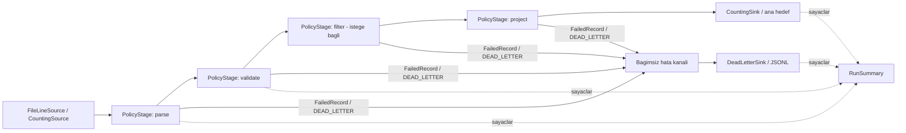

# LogFlow v5 - Sistem Mimarisi

## Artim 5: hata modeli ve dallanan topoloji



Ana hat ile hata hatti ayri hedefler ve ayri yasam donguleri kullanir. Hata kaydi ana hedefe geri beslenmez. `FailedRecord`, ozgun `rawInput`, `stageName`, `exception` aciklamasi ve UTC `timestamp` tasir. JSONL'de ayrica ham baytlarin nasil geri alinacagini belirten `rawEncoding=latin-1-bytes` bulunur. Bu dal yalnizca bir try/catch yerlesimi degildir: yapilandirmada acikca belirtilen ikinci bir cikti yoludur.

### Hata siniflari

| Tur | Anlami | Davranis |
| --- | --- | --- |
| `StageException` | Tek kaydin donusturulmesi/dogrulanmasi basarisiz; diger kayitlar islenebilir | Asamanin `onError` politikasina gider |
| `PipelineException` | Islem hatti devam edemez; kaynak acilamiyor, hedef yazilamiyor, disk/flush/close hatasi, FAIL_FAST veya tukenmis retry butcesi | Islem durur, acilmis bilesenler kapanir, basarisiz ozet yazilir; CLI 1 |
| `ConfigError : PipelineException` | Yapilandirma, tur, parametre, topoloji veya yol cakismasi hatasi | Veri I/O'sundan once reddedilir; CLI 2 |

Asamanin `open`/`close` islemindeki StageException kurtarilabilir kayit hatasi degildir; PolicyStage bunu PipelineException'a cevirir. Kaynak ve hedeflerdeki I/O hatalari dogrudan PipelineException'dir. Hata kanalinin kendisi yazilamiyorsa kayit basariyla yonlendirilmis sayilmaz; kanal hatasi hatti durdurur. Birincil hata korunur, hata sirasinda kapatilan diger bilesenlerin ikincil kapatma hatalari asil hatayi maskelemez.

### Politika sozlesmesi

Her `pipeline.stages[i]`, `type`, `params` ve istege bagli `onError` icerir. Varsayilan `SKIP`, onceki v4 yapilandirmalarinin cikti davranisini korur. Asama adi tanida `pipeline.stages[i]:type` bicimindedir; ayni turden birden fazla asama ayri olculur.

| onError | Tek kayit hatasinda karar |
| --- | --- |
| `"FAIL_FAST"` | PipelineException ile durdur |
| `"SKIP"` | dropped ve failed artir; sonraki kayda devam |
| `"DEAD_LETTER"` | FailedRecord'u ayri hedefe yaz; basarili kabulden sonra deadLettered artir |
| `{"mode":"RETRY","retries":n}` | Ilk deneme + en fazla n yeniden deneme; butce tukenirse durdur |

`n=0..1000`; tekrar denemeler gelen kayit sayisini degistirmez. RETRY su anda calisir ve gecici hata ureten asamayla test edilir; hafta 6 I/O asamalarina hazirdir. Dis sistemdeki yan etkiler icin tam bir islem garantisi vermez; bu asamalar idempotent tasarlanmalidir.

`PolicyStage<I,O>`, gercek asamayi bir `BufferedEmitter` ile cagirir. Yalnizca bu cagrinin StageException'ini yakalar. Basarili sonuclar daha sonra catch sinirinin disinda asagiya iletilir. Boylece:

- Basarisiz denemenin kismi emit ciktilari asagiya sizmaz.
- Sonraki asamanin hatasi onceki asamanin politikasiyla tekrar ele alinmaz.
- Ana sink yazma hatasi upstream RETRY nedeniyle yeniden kayit uretmez.
- Bir asamanin fan-out yapmasi sessiz sayac bozulmasina yol acmaz: bu surumun kayit asamalari 0 veya 1 cikti uretmelidir; fazlasi PipelineException'dir.

### Dogrulama ve giris sinirlari

`ValidationStage`, registry'de `validate` adiyla kayitlidir. Loader'a asama adina ozel dal eklenmemistir.

- `required`: bilinen, yinelenmeyen alan adlari. Metinde bos deger reddedilir; timestamp/status icin 0 eksik sayilir; bytes=0 gecerlidir.
- `ranges`: `status` ve `bytes` icin dahil min/max. Her sinir integer olmali, min <= max olmalidir.
- `timestamp`: UTC epoch saniyesi cinsinden dahil min/max; ornekte 2000-01-01..2029-12-31.
- `ip`: boolean; true ise IPv4/IPv6 sozdizimi denetlenir. IPv4'te gereksiz bastaki sifirlar reddedilir.

Parser takvim gecerliligini, CLF yapisini, durum kodunu, negatif/bozuk byte sayilarini ve UTF-8 kodlamasini kontrol eder. `maxLineBytes` 1..10485760 araliginda yapilandirilir; varsayilan 65536. Kaynak binary okur; UTF-8 hatalari reader tarafindan degistirilmez. Satir sonu saklanmaz; CRLF'nin CR bayti kaldirilir. Parser satiri aldiktan sonra boyut kontrolu yapar; kaynak duzeyinde sabit bellek ust siniri bu surumde yoktur.

Hata baglami, `CountingSource` tarafindan her giriste alinan ozgun satirdir. ProjectionStage ham kaydi ve atilan alanlari ana kayit nesnesinden silmeye devam eder; buna ragmen daha sonraki bir asamada hata olusursa dead-letter ozgun girdiyi tasir. Baglam islem sonunda temizlenir; ana cikti icine geri eklenmez.

### Bozuk fixture / hata turu / politika eslestirmesi

`data/access-dirty.log`, verilen ZIP'teki dosyanin aynisidir. Varsayilan gosterim `configs/dirty-dead-letter.json` ile yapilir.

| Girdi satiri / durum | Adet | Yakalandigi yer | Politika | Sonuc |
| --- | --- | --- | --- | --- |
| Bastaki `# Deliberately...` aciklamasi | 1 | parse: CLF degil | DEAD_LETTER | Tanili hata kaydi |
| Kesilmis zaman damgasi | 1 | parse | DEAD_LETTER | Tanili hata kaydi |
| Negatif byte (`-45`) | 1 | parse: CLF byte alani | DEAD_LETTER | Tanili hata kaydi |
| 1970 tarihi | 1 | validate: timestamp araligi | DEAD_LETTER | Tanili hata kaydi |
| 2099 tarihi | 1 | validate: timestamp araligi | DEAD_LETTER | Tanili hata kaydi |
| Yanit boyutu eksik satir | 1 | parse | DEAD_LETTER | Tanili hata kaydi |
| UTF-8 olmayan `FF FE FA` | 1 | parse: UTF-8 kontrolu | DEAD_LETTER | Ozgun baytlari koruyan hata kaydi |
| 102400 baytlik satir | 1 | parse: 65536 siniri | DEAD_LETTER | Tam ham satirli hata kaydi |
| Gecerli `/index.html`, `/api/login`, `/images/logo.png` | 3 | Butun asamalar | Hata yok | Ana hedefte 3 dogru TSV satiri |
| `data/access-empty.log` | 0 | kaynak | Hata yok | Basari, bos hedefler, sifir sayac |

Ayni fixture SKIP yapilandirmasiyla 8 dropped, FAIL_FAST yapilandirmasiyla aciklama satirinda 1 aborted uretir. Aciklama satiri sayim disinda birakilmaz: butun fiziksel giris satirlarinin hesabi verilir.

### RunSummary ve yasam dongusu

`RunContext`, asama metriklerini, ozgun girdiyi ve bagimsiz dead-letter sink'ini sahiplenir. `runWithSummary` her calismada sayaclari sifirlar, hata kanalini acar, mevcut PipelineBuilder ile kurulmus ana hatti calistirir, ardindan hata kanalini kapatir. Ana Pipeline once sink'i, sonra asamalari ters akis sirasinda acar; kapanis akis sirasindadir. Hata kanalini acmak basarisizsa ana hat acilmaz. Ana hattin acilisi/akisi basarisiz olursa iki yol da temizlenir.

`RunSummary`: received, emitted, asama bazinda dropped/deadLettered/failed/errors/retries, aborted, completed, elapsedMs. Filtre tarafindan bilincli elenen kayitlar dropped icindedir; hata sayisi errors/failed ile ayrica ayirt edilir. failed, politikaya son kez yonlendirilen basarisiz kayittir; errors, denemeler dahil hata sayisidir. Sure acma/isleme/kapatmayi kapsar ve steady_clock ile olculur; ozetin yazdirilma suresini kapsamaz.

Tamamlanmis calismada `received = emitted + dropped + deadLettered`. Durdurulmus calismada buna `aborted` eklenir. Sink'in basarili consume ettigi kayit emitted sayilir; flush/close basarisizsa completed=false olur, kalici depolama garantisi verilmez. Sonraki haftalarin metrikleri icin tek veri yapisi ve asama kimlikleri kullanilir. CLI ozeti stderr'e yazar; kayit stdout'unu kirletmez. Loader'in dondurdugu Pipeline'da `summary()` ile metriklere erisilir.

### Yapilandirma ve sahiplik

Yukleyici bilesenleri acmadan once tum JSON semasini, politika turlerini, gerekli hata kanalini, dogrulama kurallarini, asama sirasini, projeksiyon alan bagimliliklarini ve farkli dosya yollarini kontrol eder. `pipeline.deadLetter` yalnizca file sink kabul eder. Ana hedef, kaynak ve hata hedefi normalize edilmis ayni yolu kullanamaz. Goreli yollar calisma dizinine goredir. Windows yol karsilastirmasi buyuk/kucuk harfe duyarsizdir; dosya sistemi hard-link/symlink kimligi kontrol edilmez.

`LoadedComponents`, kaynak, asil asamalar, politika dekoratorleri, sayici adaptorler, sink ve RunContext'i sahiplenir. Dondurulen Pipeline shared ownership ile bu omru korur. Summary isaretcisi aliasing shared_ptr kullanir; loader gecici olsa da guvenlidir. Bu hat senkron ve tek is parcaciklidir. Ayni Pipeline es zamanli calistirilmaz.

### Dogrulama

MSVC ile 9 test programinda **367/367 dogrulama** basarili. Testler tam ana cikti karsilastirmasini, sekiz hata girdisini, JSONL tani alanlarini, uzun satir ve UTF-8 bayt korunmasini, yeniden calistirma/sayac sifirlamasini, dort politikayi, retry tukenmesini ve downstream yalitimini, IP ve aralik sinirlarini, bos girdi ve fatal I/O'yu kapsar. Eski parser/builder/entegrasyon testleri acik StageException ve SKIP dekoratoru sozlesmesine guncellenmistir. Windows derleme betigi negatif test islem cikis kodlarinda da durur.

---

## Onceki artimlarin mimari gecmisi

Asagidaki bolumler Artim 3 ve 4'un tasarim gecmisidir. Guncel hata sozlesmesi yukaridaki Artim 5 bolumudur; eski parser'in sessiz atlama davranisi yururlukte degildir.

### Artim 3-4 tasarim notlari

Guncel yapilandirma semasi ve registry tasarimi asagidaki **Artim 4** bolumundedir.
Onceki Artim 3 tasarim kararlari ve deneyleri temel mimarinin belgesi olarak korunmustur.

**Mimari odak:** modulerlik, bilesilebilirlik, asama duzeyinde tek sorumluluk.

## Mimari Diyagram

```
                       PipelineBuilder::from(...).via(...).via(...).to(...)
                                          │ kurar
                                          ▼
FileLineSource ─► ParserStage ─► PredicateFilterStage ─► ProjectionStage ─► FileSink
   (Source)      string→Record     Record→Record (1→0/1)   Record→Record (1→1)   (Sink)
   Source<string>  Stage<string,   Stage<Record,Record>    Stage<Record,Record>  Sink<Record>
                   Record>
        └──────────────── Emitter (adaptorler) ────────────────┘
```

Filtre ve projeksiyon **ayni arayuzdur** (`Stage<LogRecord, LogRecord>`): biri kaydi
eler (1→0 ya da 1→1), digeri donusturur (1→1). Hat icin ikisi arasinda fark yoktur;
bu yuzden herhangi bir sirada, herhangi bir sayida eklenebilirler.

## Bilesenler

| Bilesen | Sorumluluk (tek) | Durum |
|---------|------------------|-------|
| `Source<T>` / `FileLineSource` | veri uretir | degismedi |
| `Emitter<T>` | veriyi bir sonrakine iletir | degismedi |
| `Stage<I,O>` / `ParserStage` | tek bir donusum | degismedi |
| `Sink<T>` | veriyi tuketir | **`open()`/`close()` eklendi** |
| `PredicateFilterStage` | kosulu saglamayan kaydi eler | YENI |
| `ProjectionStage` | kaydi secilen alanlara indirger | YENI |
| `FileSink` | kayitlari dosyaya yazar | YENI |
| `PipelineBuilder` / `PipelineStep<T>` | asamalari tip guvenli birlestirir | YENI |
| `Pipeline` | kurulu hatti calistirir, yasam dongusunu yonetir | **yeniden yazildi** |
| `Predicates` | hazir kosullar (`statusAtLeast`, `pathStartsWith`, `timestampBetween`) | YENI |
| `LogFields` | alan adlari ve metin gosterimi (tek dogruluk kaynagi) | YENI |
| `CommandLine` | argumanlari `Options`'a cevirir | YENI |

## Tasarim Kararlari

### 1. PipelineBuilder: tip guvenli, sira ve sayi serbest

```cpp
Pipeline p = PipelineBuilder::from(source)     // PipelineStep<string>
                 .via(parser)                  // PipelineStep<LogRecord>
                 .via(filter)                  // PipelineStep<LogRecord>
                 .via(projection)              // PipelineStep<LogRecord>
                 .to(sink);                    // Pipeline
p.run();
```

* `via()` yalnizca girdi tipi **zincirin o anki cikti tipine** uyan bir `Stage` kabul eder.
  `string` akarken bir filtre eklemeye calismak, program calismadan **derleme hatasi** verir.
* `from()` / `via()` zinciri kucuk bir islev bilesimi olarak kurar: her `via()`, onceki
  zinciri saran yeni bir islev uretir. Bellekte ayrica bagli liste, `void*` ya da
  calisma zamani tip denetimi yoktur.
* Builder asamalari **sahiplenmez**; nesneler `run()` bitene dek cagiran tarafta yasar.
  Secenege bagli asamalar icin `main.cpp`, asamalari `unique_ptr` listesinde tutar ve
  donguyle `via()` cagirir (`filtre` ve `projeksiyon` ayni tip oldugundan bu mumkundur).
* **Neden eski `Pipeline<I,O>` kaldirildi?** Tek asamaya (`Source→Stage→Sink`) sabitlenmisti.
  Yeni `Pipeline` tipten bagimsizdir; tipler builder'in icinde derleme zamaninda denetlenir.
* 4. haftada yapilandirma dosyasi bu builder'i kullanacak: asama listesini dosyadan okuyup
  ayni `via()` cagrilarini yapacak; builder'in kendisi degismeyecek.

### 2. Yasam dongusu (lifecycle) artik gercek

| Olay | Sira | Gerekce |
|------|------|---------|
| `open()` | sink → ... → kaynaga en yakin asama | hedef hazir olmadan veri akmasin |
| `close()` | kaynaga en yakin asama → ... → sink | asamalardaki arabellek, hedef kapanmadan bosalsin |

* `open()` yarida hata verirse, o ana kadar acilanlar kapatilir.
* Akis sirasinda hata olursa `close()` **yine cagrilir**; asil hata korunur.
* Normal bitiste `close()` hatasi (disk dolu vb.) **bildirilir**, yutulmaz.
* `FileSink::close()` arabellegi bosaltir, akisi kapatir ve hatayi denetler. `close()`
  hic cagrilmayan bir dosya sink'i, arabellekteki son satirlari sessizce kaybedebilir
  ve yazma hatalarini fark etmez; hattin her kosulda `close()` cagirmasi bu yuzden
  mimarinin parcasidir, sus degildir. Testler: `FileSinkTests`, `PipelineBuilderTests`.

### 3. Projeksiyon ve veri minimizasyonu

`ProjectionStage` secilmeyen alanlari bosaltir (metin `""`, sayi `0`) ve **ham satiri
(`raw`) ile `attributes`'u her zaman atar**: ham satir, secilmeyen alanlarin (IP,
user agent, sorgu dizesindeki veriler) tamamini icerir; atilmasaydi projeksiyon
yalnizca gorunuste bir gizlilik onlemi olurdu.

Cikti hâlâ `LogRecord` oldugundan projeksiyon hattin her yerine konabilir. Bedeli:
**projeksiyondan sonra gelen filtre, atilmis alani yalnizca bos/0 degeriyle gorur**
(Deney C).

### 4. Cikti bicimi

`ConsoleSink` ve `FileSink` bir `RecordFormatter` alir. `--fields` verilirse secilen
alanlar, verilen sirayla, TAB ile ayrilarak yazilir (baslik satiri yok); verilmezse
v2'deki okunabilir tek satirli bicim kullanilir.

## Asama Eklemek Neleri Degistirdi?

* **Yeni:** `PredicateFilterStage.h`, `ProjectionStage.h`, `FileSink.h`, `Predicates.h`,
  `LogFields.h`, `PipelineBuilder.h`, `CommandLine.h`.
* **Degisen:** `Sink.h` (yalnizca varsayilan `open()/close()` eklendi), `Pipeline.h`,
  `ConsoleSink.h` (bicimleyici alir), `main.cpp`.
* **Degismeyen:** `Emitter.h`, `Source.h`, `Stage.h`, `FileLineSource.h`, `LogRecord.h`,
  `ParserStage.h`. Uc yeni asama, mevcut arayuzlere **dokunmadan** eklendi.

## Siralama Deneyi (Gorev 4)

`experiments/OrderExperiment.cpp` (`make experiment`): 500 000 satirlik, sabit tohumlu
sahte log; ≈%10 kayit `status >= 400`, ≈%30 kayit `/api`. Ayni asama turleri, yalnizca
`via()` sirasi degisir. Sayaclar **kesindir** (her calistirmada ayni); sureler en iyi
5 calistirmadir ve makineye gore degisir (ayni yapilandirma uc calistirmada
≈220–250 ms arasinda oynadi).

**Baslangic noktasi: ayristirmadan once filtrelemek mumkun degildir.** Kosullar
`LogRecord` alanlarina bakar; `ParserStage` her zaman ilk filtreden once gelmek zorundadir.
Bu, siranin bir *bagimlilik* tarafindan belirlendigi durumdur. Asagidakiler ise gercek
tercihlerdir. Ayristirma tek basina toplam surenin kabaca ucte ikisini olusturur
(ayri olcum: 500 000 satir ≈175 ms), bu yuzden asagidaki sure farklari o tabanin ustunde kalir.

### Deney A - iki filtrenin sirasi (`status >= 400` ve `path` onek `/api`)

| Sira | durum sinama | yol sinama | cikti | sure |
|------|-------------:|-----------:|------:|-----:|
| durum → yol | 500 000 | 49 656 | 14 941 | ≈220–250 ms |
| yol → durum | 150 668 | 500 000 | 14 941 | ≈240–250 ms |

* **Cikti ozdes** (satir satir karsilastirildi).
* Daha eleyici filtre (`status`, ≈%10 gecer) once gelince toplam kosul sinamasi
  549 656'ya duser; ters sirada 650 668 (**≈%18 fazla**).
* Sure farki gurultunun icinde kaldi: iki kosul da cok ucuz (bir tamsayi karsilastirmasi
  ve kisa bir onek karsilastirmasi). Kural: **ucuz ve daha eleyici olani one al**; kosullar
  pahali olsaydi (duzenli ifade, arama) fark sureye de yansirdi.

### Deney B - projeksiyon filtreden once mi, sonra mi?

| Sira | projekte edilen kayit | cikti | sure |
|------|----------------------:|------:|-----:|
| durum → yol → projeksiyon | 14 941 | 14 941 | ≈220–250 ms |
| projeksiyon → durum → yol | 500 000 | 14 941 | ≈290–330 ms |

* **Cikti ozdes**; ama projeksiyon her kayit icin yeni bir `LogRecord` (dizgi kopyalari,
  bellek ayirma) uretir. Filtre once gelince **33 kat daha az** kayit projekte edilir ve
  uc calistirmanin ucunde de daha hizlidir (projeksiyon-once ≈%15–45 daha yavas).
* Filtre once de gizlilik acisindan zararsizdir: elenen kayitlar hic kopyalanmaz.

### Deney C - projeksiyon, filtrenin alanini atarsa

`--fields timestamp,clientIp,path` ( `status` yok):

| Sira | cikti |
|------|------:|
| filtre → projeksiyon | 14 941 satir |
| projeksiyon → filtre | **0 satir** |

Projeksiyon once calisinca `status` 0 olur ve `status >= 400` hicbir kayda uymaz.
**Sira burada sonucu degistirir**, hata vermeden. Bu yuzden komut satiri programi filtreleri
her zaman projeksiyondan **once** kurar; sira, tasarimin bir parcasi olarak sabittir.

### Sonuc

* Filtre sirasi: sonucu degistirmez, **is miktarini** degistirir (bagimsiz filtreler).
* Filtre/projeksiyon sirasi: kural olarak **once filtre** (hem daha az is hem guvenli);
  projeksiyonun once gelmesi yalnizca filtrelerin kullandigi tum alanlar korunuyorsa
  *ayni sonucu* verir.
* Ayristirma, hep ilk asamadir (bagimlilik).

## Artim 4 — Yapilandirma Semasi ve Registry

Artim 4'te topoloji `main.cpp` disina tasinmistir. Akis:

```text
JSON -> ConfigParser -> ConfigValue (turlu agac)
     -> PipelineLoader -> StageRegistry[name] -> StageFactory(params)
     -> sahip olunan source / parser / record stages / sink
     -> mevcut PipelineBuilder -> Pipeline -> run()
```

### JSON semasi

Kok yalnizca `pipeline` nesnesini icerir. Asagidaki alanlarin hepsi zorunludur; bilinmeyen anahtarlar yazim hatalarini gizlememek icin reddedilir.

| Yol | Tur / kural |
| --- | --- |
| `pipeline.name` | Bos olmayan metin; hattin aciklayici adi |
| `pipeline.source` | `{ "type": "file", "params": { "path": "..." } }` |
| `pipeline.stages` | Bos olmayan asama dizisi, sirasi aynen korunur |
| `pipeline.stages[i]` | `{ "type": "kayitli-ad", "params": { ... } }` |
| `pipeline.sink` | Dosya: `{ "type": "file", "params": { "path": "..." } }`; konsol: `{ "type": "console", "params": {} }` |

Asama fabrikalari kendi parametre semalarina sahiptir:

| Kayitli tur | Parametreler | Girdi -> cikti |
| --- | --- | --- |
| `parse` | `format`: metin, yalnizca `clf` | string -> LogRecord; yalnizca ilk sirada |
| `filter` | `field`: bilinen alan, `op`: karsilastirma, `value`: alanla uyumlu tur | LogRecord -> LogRecord (0 veya 1) |
| `project` | `fields`: bos olmayan, tekrarsiz, bilinen alan adlari dizisi | LogRecord -> LogRecord |

`filter.op`: `==`, `!=`, `>=`, `<=`, `>`, `<`; metin alanlari icin ayrica `startsWith`. `status` ve `bytes` degerleri JSON tamsayisidir (tirnakli sayi, ondalik sayi, bool ve null kabul edilmez). Status 100..599, bytes >= 0 olmalidir. Diger alanlarda bos olmayan metin gerekir; karsilastirma buyuk/kucuk harfe duyarlidir. `timestamp` karsilastirmasi UTC ISO metniyle yapilir; sayisal epoch kabul edilmez. Sirali tarih karsilastirmalarinda `YYYY-MM-DDTHH:MM:SSZ` bicimini kullanin.

Dosya yollari calisma dizinine goredir. Girdi ve cikti ayni normalize dosya yolu olamaz. Cikti ust klasoru mevcut olmalidir. Projeksiyon sonrasi TSV bicimi son projeksiyonun alan sirasini kullanir; projeksiyon yoksa mevcut okunabilir ConsoleSink bicimi kullanilir.

### Yasam suresi ve dogrulama

`PipelineLoader.load()` dosyayi okur, `loadText()` dogrular ve `Pipeline` dondurur. Dogrulama sirasinda kaynak uretilmez, sink acilmaz. Asama fabrikalari yalnizca nesne kurmalidir; I/O veya yan etki yapmamalidir. Yukleyici gecerli topolojiyi mevcut builder ile birlestirir; `shared_ptr<LoadedComponents>` donen hattin fonksiyonunda saklanir. Loader ve gecici degerler yok olsa da bilesenler calistirma tamamlanana kadar yasar. Mevcut Pipeline'in hata durumunda kapatma ve hata koruma davranisi kullanilir.

`StageInstance` parser veya kayit asamasi tasir. `requiredFields` asamanin ihtiyac duydugu alanlari, `fields` projeksiyondan sonra korunan alanlari bildirir. Yukleyici fabrika metadatasindan tur sirasini ve silinmis alan bagimliliklarini denetler; asama turu adina gore dallanmaz. Tekrar projeksiyon once silinen alani geri getiremez.

`StageRegistry` bir `std::map<std::string, StageFactory>` kullanir. Tek yerlesik kayit tablosu `BuiltinStages::registry()` icindedir. Yinelenen, bos isimli veya bos fonksiyonlu kayit reddedilir. Ozel bir registry `PipelineLoader(registry)` ile verilebilir. Yeni kayit fabrikasi eklemek loader degisikligi gerektirmez; testte `select` adiyla alternatif fabrika kaydi kullanilir. Bu C++ cozumu tek kayit tablosu yaklasimidir; DLL yukleme veya reflection gerektirmez.

### Hata ayrimi ve teslim ornekleri

`ConfigError`: sozdizimi, eksik/yanlis tur, bilinmeyen isim, topoloji veya parametre hatasi; dosya ve alan yolu gosterilir, CLI cikis kodu 2. JSON sozdizimi hatalarinda satir/sutun bildirilir; yinelenen nesne anahtarlari reddedilir; Unicode kacislari desteklenir, ic ice veri derinligi 64 ile sinirlandirilir.

`StageException`: gecerli hattin calistirilmasi sirasinda dosya erisimi/yazma/okuma hatasi; CLI cikis kodu 1. Hatali log satirlarini atlayan mevcut parser politikasi korunur. Artim 5'in veri hatasi politikasi bu surumun kapsami degildir.

- `configs/error-report.yaml`: status >= 400; timestamp, clientIp, status, path -> out/errors.txt.
- `configs/api-traffic.json`: path startsWith /api; timestamp, method, path, status -> out/api-traffic.tsv.
- `configs/bandwidth-by-client.json`: clientIp, bytes -> out/bandwidth-by-client.tsv. Bu bir cikarimdir; istemci basina toplama icermez.

JSON secimi PDF'nin YAML veya JSON gereksinimini karsilar. PDF'deki tam komut icin `.yaml` adli ilk dosya JSON (YAML 1.2 altkumesi) icerir. Yalniz JSON sozdizimi desteklenir; klasik girintili YAML desteklenmez.
